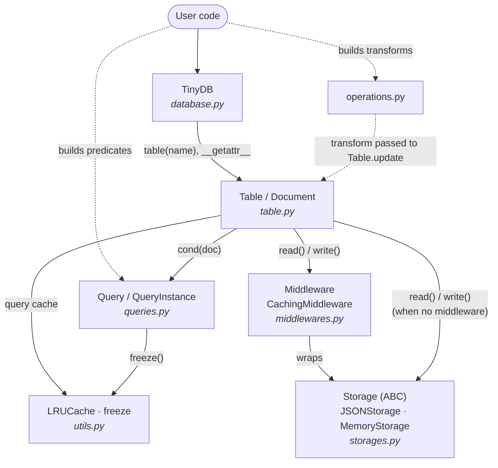

# TinyDB Architecture

**Scope.** This document describes TinyDB as it exists at commit `edff96a`. It is
written for a developer who has to change this codebase without having met it
before. It covers what the main components are, which ones call which, three
decisions that shaped the design, and five rules that must not be broken.

TinyDB is a document-oriented database that lives in a single Python package of
about 2,300 lines with **no runtime dependencies**. The whole database is held
as one nested `dict` and handed to a pluggable storage backend to persist.

---

## 1. Components

| # | Component | File | Responsibility |
|---|-----------|------|----------------|
| 1 | `TinyDB` | `tinydb/database.py` | Public facade. Owns the storage instance and the set of named tables; forwards unknown attribute access to the default table. |
| 2 | `Table` / `Document` | `tinydb/table.py` | All CRUD. Owns the per-table query cache. The only component that reads and writes table contents. |
| 3 | `Query` / `QueryInstance` | `tinydb/queries.py` | Builds callable, hashable predicates over documents. Pure: knows nothing about tables or storage. |
| 4 | `Storage` / `JSONStorage` / `MemoryStorage` | `tinydb/storages.py` | Persistence. Serialises and deserialises the entire database as one `dict`. |
| 5 | `Middleware` / `CachingMiddleware` | `tinydb/middlewares.py` | Optional wrappers that sit between `Table` and a `Storage` and intercept `read`/`write`. |
| 6 | operations | `tinydb/operations.py` | Small factory functions (`add`, `set`, `delete`, …) returning document transforms for `Table.update`. |
| 7 | utilities | `tinydb/utils.py` | `LRUCache` (backs the query cache), `freeze`/`FrozenDict` (makes query arguments hashable), `with_typehint`. |

### How they fit together

**Direction of dependency.** `table.py` imports `queries.py`, `storages.py` and
`utils.py`. Nothing imports `table.py` except `database.py`. `queries.py` imports
only `utils.py`. The arrows above never run backwards: this is what keeps the
query language independent of how documents are stored.

**The one data shape everything agrees on.** Storage reads and writes a single
nested dictionary, `{table_name: {doc_id_as_str: document}}`. `Table` converts
the string document IDs to `document_id_class` (`int`) on the way in and back to
strings on the way out, because JSON object keys can only be strings.

---

## 2. Architecture Decision Records

### ADR-1: Storage is a two-method interface over the whole database

**Status:** Verified — `tinydb/storages.py:36-76`; commit `02ee040` ("Feat: implement direct storage access").

**Context.** TinyDB has to support very different persistence targets: a JSON
file, memory for tests, and third-party backends (YAML, in-browser, compressed
files) that the project does not ship.

**Decision.** `Storage` is an abstract base class with exactly two abstract
methods, `read()` and `write(data)`, plus an optional `close()`. Both operate on
the **entire database** as one `dict`, not on individual tables or documents.

**Alternatives considered.** A richer interface with per-document or per-table
operations (`get`, `put`, `delete`) would allow backends to do incremental
writes, and a real key-value or SQL backend would be much more efficient that
way. It was not chosen because it pushes query semantics and ID allocation down
into every backend, which would make writing a new storage hard rather than
trivial.

**Consequences.** Writing a new storage is very cheap — two methods. The price is
that *every* mutation rewrites the whole database: `Table._update_table` reads
all tables, mutates one, and writes all tables back. This is why TinyDB is a
"tiny" database and not a general-purpose one, and it is why `CachingMiddleware`
exists at all.

### ADR-2: Middlewares wrap storages by delegation, not by inheritance

**Status:** Verified — `tinydb/middlewares.py:10-73`; commit `eb3068d` ("Move serialization to a middleware").

**Context.** Behaviour like write-caching or serialisation has to apply to
*any* storage, including ones TinyDB has never seen.

**Decision.** `Middleware` is a plain class that does **not** subclass `Storage`.
It takes a storage *class* in its constructor, instantiates it inside
`__call__`, and forwards every attribute it does not define to the wrapped
instance via `__getattr__`. This is what makes
`TinyDB(storage=CachingMiddleware(JSONStorage))` work: `TinyDB.__init__` calls
`storage(*args, **kwargs)` without caring whether `storage` is a class or an
already-constructed middleware instance.

**Alternatives considered.** Making `Middleware` subclass `Storage` would be the
obvious object-oriented choice and would give type checkers more to work with.
It was rejected because a middleware must be able to pass through methods the
base interface does not declare (`JSONStorage.close`, backend-specific helpers),
and because a middleware is constructed before it knows its storage's
constructor arguments.

**Consequences.** Middlewares nest freely, and a middleware stays transparent to
backend-specific API. The cost is that middlewares are invisible to static type
checking and that `__getattr__` forwarding hides typos: a misspelled attribute
silently resolves against the wrapped storage instead of raising.

### ADR-3: Query results are cached per table, keyed by the query's own hash

**Status:** Verified — `tinydb/queries.py:58-135`, `tinydb/table.py:249-298`; commits `a1fa290` ("Don't hand out references to the query cache"), `e83efcd` ("fix: include regex flags in matches/search query hash (#640)").

**Context.** Because of ADR-1, every `search()` deserialises and scans the entire
table. Repeating the same search is common and expensive.

**Decision.** Each `Table` owns an `LRUCache` (default capacity 10) mapping a
query to its result list. The cache key is the query object itself, so
`QueryInstance` carries a `_hash` tuple — a `hashval` such as
`('==', path, value)` — that uniquely describes the query, and implements
`__hash__` and `__eq__` on it. A query that cannot be described this way (one
built from an arbitrary callable, via `.map()` or `.test()` with mutable state)
sets `_hash = None`, reports `is_cacheable() == False`, and is never cached.

**Alternatives considered.** Caching by the query's `repr()` string was simpler
but collides for queries that print the same, and caching nothing at all was
rejected for the obvious performance reason.

**Consequences.** This is the single most dangerous coupling in the codebase.
Correctness of `search()` depends on a property of `queries.py` that `table.py`
cannot check: **two queries that mean different things must not produce the same
hashval.** Issue #640 is exactly this bug — `matches(r'x')` and
`matches(r'x', re.IGNORECASE)` once hashed alike and returned each other's
cached results. The fix was in `queries.py`, but the symptom appeared in
`table.py`. Any new query method inherits this obligation. A second consequence:
`search()` returns a copy of the cached list, but the *documents* in it are
shared objects — mutating one corrupts what a later identical search returns
(`tinydb/table.py:252-257`).

---

## 3. Constraints

Rules a developer must not break when changing this code.

| # | Constraint | Where the rule can be seen |
|---|-----------|----------------------------|
| C1 | **A new storage must subclass `tinydb.storages.Storage` and implement `read()` and `write()`.** `Storage` is an `ABC` with `@abstractmethod`s, so a storage that does not is not instantiable. New storages belong in `storages.py` and must be added to its `__all__`. | `tinydb/storages.py:13,36,47,59`; existing subclasses at `:79`, `:164` |
| C2 | **`queries.py` must not import `table.py` or `storages.py`.** The query language is a leaf: dependencies run `database.py → table.py → queries.py → utils.py`. Introducing the reverse edge creates an import cycle, because `table.py` imports `queries.py` at module level. | `tinydb/queries.py:19-23` (imports only `re`, `collections.abc`, `typing`, `.utils`); `tinydb/table.py:15` |
| C3 | **Every cacheable query must build its `hashval` from an operator tag, `self._path`, and all of its arguments** (frozen with `freeze()` where they may be mutable). Omitting any of these makes two different queries compare equal and silently swap results through the table query cache. Build query methods with `_generate_test`, which enforces path resolution. Note: `_generate_test` uses `hashval` exactly as given and does **not** add the path; every method must put `self._path` into its own `hashval`. | `tinydb/queries.py:218-243`, and every method on `Query`, e.g. `:263`, `:355`, `:486`; consumed at `tinydb/table.py:265`, `:287-296` |
| C4 | **TinyDB must keep zero runtime dependencies.** The package uses only the standard library; `[project]` in `pyproject.toml` declares no `dependencies` key. A new feature must not add one. | `pyproject.toml` `[project]` block |
| C5 | **All table mutations must go through `Table._update_table`.** It performs the read-modify-write of the whole database, converts document IDs in both directions, and — critically — invalidates the query cache afterwards. Writing to `self._storage` directly from a table method leaves a stale query cache. | `tinydb/table.py:804-854` (cache invalidation at `:854`); callers at `:175`, `:228`, `:468`, `:651` |

---

## 4. Claim check

Ten factual claims from this document, each looked up in the code at commit
`edff96a`.

| # | Claim | Where checked (file:line) | Correct? | Fix made |
|---|-------|---------------------------|----------|----------|
| 1 | `Storage` is an abstract base class with abstract `read` and `write` | `tinydb/storages.py:36,47,59` | Yes | None |
| 2 | `JSONStorage` and `MemoryStorage` both subclass `Storage` | `tinydb/storages.py:79,164` | Yes | None |
| 3 | `Middleware` does **not** subclass `Storage`; it forwards via `__getattr__` | `tinydb/middlewares.py:10,67` | Yes | None |
| 4 | `CachingMiddleware` flushes after 1000 cached writes | `tinydb/middlewares.py:86,117` | Yes | None |
| 5 | `TinyDB` uses `JSONStorage` when no storage is passed | `tinydb/database.py:85,92` | Yes | None |
| 6 | `TinyDB` forwards unknown attributes to the `_default` table | `tinydb/database.py:80,251-255` | Yes | None |
| 7 | The per-table query cache holds 10 entries by default | `tinydb/table.py:88-92,108` | Yes | None |
| 8 | `Table.search` consults the query cache before scanning the table | `tinydb/table.py:264-267` | Yes | None |
| 9 | `Table._update_table` clears the query cache after writing | `tinydb/table.py:854` | Yes | None |
| 10 | `queries.py` imports nothing from `table.py` or `storages.py` | `tinydb/queries.py:19-23` | Yes | None |

No claim in the table needed correcting. Two claims were revised *before* this
table was finalised, while drafting: an early draft stated that `Middleware`
subclasses `Storage` (it does not — `middlewares.py:10`), and that the default
query cache capacity was unlimited (it is 10 — `table.py:92`). Both were wrong
and were corrected against the code; they are recorded here rather than in the
table because the table reports the state of the document as submitted.
