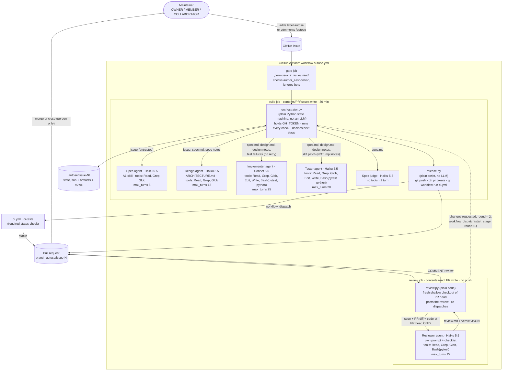

# Component view

The components, the tools and permissions each one holds, and how they call each other.
The token boundary is the key feature: **only plain code (orchestrator, release script)
holds a GitHub token. No LLM agent does.**

| Component | Kind | Model | GitHub token? | Can push? |
|---|---|---|---|---|
| gate | Actions job (bash) | — | read (issues) | no |
| orchestrator.py | plain Python | — | **yes** | yes (branch `autose/*` only; `main` is protected) |
| Spec / Design / Tester agents | LLM agent | Haiku 5.5 | **no** | no |
| Implementer agent | LLM agent | Sonnet 5.5 | **no** | no (it edits files; the orchestrator commits them) |
| Spec judge | LLM, single call | Haiku 5.5 | no | no |
| release.py | plain Python | — | yes | yes (branch only) |
| review.py | plain Python | — | yes (PR write, contents **read**) | **no** |
| Reviewer agent | LLM agent | Haiku 5.5 | **no** | no |
| ci.yml | Actions workflow | — | contents read | no |
